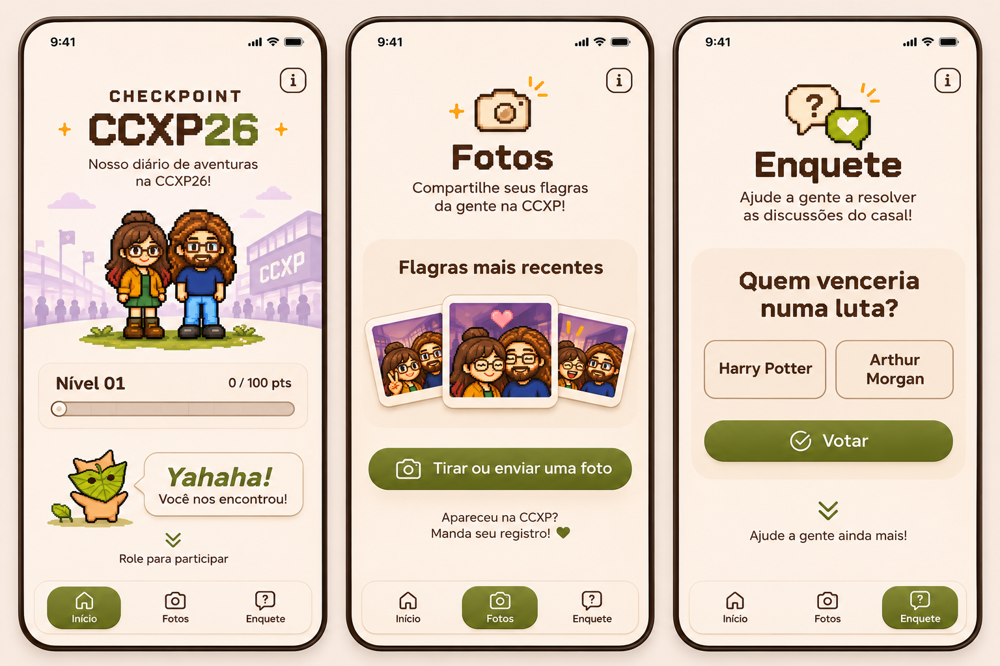

# Checkpoint CCXP26 — Design System & UX Specification

> **Referência visual histórica:** este documento registra decisões de design ao longo da implementação. Para API e comportamento atuais, prevalecem `CONTRATO_API.md`, `README.md` e o código.

> Atualização de participação: três enquetes distintas atribuídas localmente, continuação manual após cada voto confirmado e resultados liberados após as três respostas. Uma foto simulada por visitante, com limite persistido; nenhum arquivo é transmitido nesta versão. Resultados e XP são demonstrativos. Esta decisão substitui as descrições históricas de prévia sem confirmação abaixo; detalhes em `PARTICIPACAO_MOCK.md`.

> Atualização da progressão: a Home usa os nomes Desconhecidos, Amigos, Namorados, Noivos e Casados, com patamares acumulados 0/3/7/12/19 XP e progresso relativo ao próximo patamar; Casados é final. A pontuação atual é de demonstração local. Detalhes e limites da futura API estão em `PROGRESSAO_XP.md`. Esta decisão substitui os exemplos históricos de “Nível 01 / 0 de 100 pontos” abaixo.

> Atualização de navegação: a barra inferior está temporariamente desativada e não ocupa espaço. As telas usam toda a altura disponível, respeitando as áreas seguras; a navegação vertical continua por gestos, rolagem e teclado. O componente pode ser reativado em `ScreenStack.astro`.

## Checkpoint Motion System — v1.1

Regras atuais, substituindo o fade de superfície e a entrada única do grupo de Polaroids da v1:

- **Camadas da Home:** `.scene-composition` mantém `z-index: 0`; `.welcome` é posicionada com `z-index: 1`. A cauda creme do raster excede a caixa do cenário e deve permanecer atrás do progresso, inclusive quando o parallax cria um contexto de empilhamento. Em repouso na Home, remover o transform de parallax em vez de deixar `translateY(0px)` inline.
- **Navegação direta:** troca imediata para o destino, sem telas intermediárias, sem animar opacity do viewport; apenas deslocamento de 6 px do conteúdo de chegada por 160 ms. Fundo permanece opaco. Gestos verticais e encaixe amortecido da v1 continuam funcionando.
- **Coreografia na primeira visita:** estado simples em memória, por tela, em `src/scripts/screen-entrance.ts`. Enquete e Fotos são preparadas antes de aparecer durante o gesto, evitando mostrar o estado final antes da animação; a coreografia dispara após o destino ser confirmado. Retornos não repetem a apresentação; reload permite nova entrada. Entradas gerais duram 580 ms e as variantes aprovadas têm durações próprias abaixo; curva `cubic-bezier(.22,.75,.25,1)`, deltas pequenos, sem escala do lettering/sprites.
- **Home:** logo (delay 0), Juh (160 ms), Átila (300 ms), progresso (390 ms), e Korok em **A1 Peek & Pop** (480 ms, 750 ms de duração): espreita com máscara temporária, antecipa, sobe e acomoda. Em seguida o balão se abre do lado do mascote e revela o texto. Nunca animar valores do progresso.
- **Enquete:** ícone (0), título (120 ms), subtítulo (220 ms), pergunta (340 ms); **C1 Duel Entrance**: alternativas entram de lados opostos em 180/270 ms e acomodam em 670 ms. Seleção direta e ícones preservados; interagir cancela a apresentação. A resposta avança imediatamente, com entrada sutil de 160 ms para a nova pergunta e foco automático apenas na navegação por teclado.
- **Fotos:** cabeçalho discreto; após decodificação, **B1 Card Fan** abre as Polaroids de uma pilha para o leque, com delays 0/45/70 ms e duração de 720 ms; CTA entra em 320 ms. Os keyframes terminam nos transforms computados do leque existente, depois são removidos: a geometria final pertence ao CSS, não à animação.
- **Limpeza:** sem `fill: forwards` nas entradas. Usar preenchimento apenas durante o pequeno stagger (`backwards`), tratar rejeição de `finished` e cancelar efeitos ao terminar. Navegação, gesto, interação, resize, página oculta e preferência de movimento invalidam callbacks pendentes. Uma tela que ficou inativa não pode receber efeitos atrasados da decodificação de imagens.
- **Falhas e movimento reduzido:** sem JavaScript o CSS estático permanece visível. Durante a preparação, o leque aguarda a decodificação por até 1,2 s; cancelamento ou timeout libera o conteúdo. `prefers-reduced-motion` elimina ocultação preparatória, coreografias e parallax, mantendo controles e navegação. Não há novas imagens, bibliotecas ou trabalho contínuo em repouso.

## Checkpoint Motion System — v1 (histórico)

Esta seção substitui as decisões históricas de motion abaixo. Fluxo preservado: Início → Enquete → Fotos.

| Interação | Movimento | Tempo / curva |
|---|---|---|
| Arraste vertical | Conteúdo acompanha o dedo via scrollTop; direção pode ser invertida | Controle direto durante o gesto |
| Soltura | Encaixe monotônico, sensação amortecida, sem overshoot | 260 ms, desaceleração `1 − (1 − t)^4` |
| Toque na barra / soltura da cápsula | Fade Through, troca direta sem telas intermediárias | 85 ms de saída + 115 ms de entrada |
| Home em deslocamento | Composição completa (cenário e personagens juntos) desloca até 8 px | Proporcional ao scroll, sem movimento em repouso |
| Informações | Container Transform do ícone ao diálogo modal, reversível | `--duration-container: 280ms`, `cubic-bezier(.2,.8,.2,1)` |
| Prévia local de foto | Expansão a partir do CTA após o seletor nativo retornar; recolhimento ao cancelar | Mesmos tokens do painel de informações |
| Resposta da enquete | Estado selecionado imediato, escala .97 e contorno interno antes de avançar | 120 ms de feedback; transição de pergunta existente preservada |
| Polaroids | Fade + subida de 6 px apenas na primeira apresentação | 220 ms, `cubic-bezier(.2,.8,.2,1)` |

**Gestos:** intenção vertical após 8 px; distância limitada a uma tela por gesto. Avançar ao ultrapassar 25% da altura útil, ou com velocidade recente >0,5 px/ms e deslocamento mínimo de 24 px na mesma direção. Movimento curto/lento retorna; cancelamento retorna à tela de origem. Durante o encaixe, novas navegações são ignoradas; resize/mudança de preferência cancela e alinha em um destino válido. Formulários, botões, links e informações preservam seus gestos. Rolagem interna tem prioridade e nunca transfere a mesma intenção para troca de tela após chegar ao limite. Touch Events não-passivos ficam restritos ao viewport; não há `touch-action: none` global. Mouse/pen usam Pointer Events para o arraste; wheel/teclado mantêm navegação discreta.

**Acessibilidade:** `prefers-reduced-motion` desativa parallax, deslocamento durante o arraste e animações elaboradas; a decisão de destino e os controles continuam funcionais. Diálogo nativo de informações mantém o restante da interface inerte, fecha com Escape/botão/overlay e devolve foco à origem. Sem JavaScript, links e CSS Scroll Snap mantêm acesso às telas, informações usam details/summary e imagens adiadas têm fallback noscript.

**Performance:** sem dependências novas, timers ou rAF contínuos em repouso. Frames de encaixe só durante 260 ms; parallax agenda no máximo um frame por scroll. Container Transforms medem caixas uma vez e animam transform/opacity pela Web Animations API; o scrollTop é usado apenas no scrollport existente, sem medir/posicionar todos os componentes a cada frame. Sem blur, novos assets ou will-change permanente. O protocolo de imagens sob demanda permanece.

> Refinamento responsivo: o shell reserva a navegação uma única vez em sua própria linha, com `100dvh` e safe area. Fotos não exibe a antiga legenda complementar; cabeçalho, leque e CTA adaptam espaçamentos e ilustrações à altura útil. Na Enquete, alternativas permanecem lado a lado sempre que houver largura suficiente, preservando os alvos de toque e a seleção direta. Em telas muito pequenas ou com texto ampliado, a rolagem interna é o fallback acessível.

> Atualização: a Enquete não mostra quantidade de perguntas nem indicadores de progresso. Ao terminar as perguntas disponíveis, apresenta estado de respondido; os dados atuais são apenas demonstração e não são enviados. O ícone de informação em cada tela abre uma explicação específica, editável posteriormente. O foco de teclado permanece visível em oliva, sem contorno roxo; o painel de Fotos usa superfície mais próxima do fundo e tipografia mais encorpada.

> **Arquivo normativo para agentes de desenvolvimento HTML/CSS/JS**
> Versão: `2.5.0` · Estado: **aprovado para implementação** · Idioma da interface: `pt-BR`



## 0. Contrato de implementação (leia antes de codificar)

**Referência visual única:** `prototipo3Paginas.png`, correspondente à **última composição minimalista aprovada** (três smartphones lado a lado: Home, Fotos e Enquete). O cenário autorizado está em `background.png`. Mockups anteriores, tentativas mais ornamentadas e estudos de paleta não são fonte de verdade.

**Revisão normativa 2.0:** as decisões abaixo substituem a landing page contínua e as interpretações das primeiras implementações. Não reintroduzir o botão “Explorar o Checkpoint”, a seção Sobre no fluxo principal, Press Start 2P na marca ou Pixelify no indicador de nível. Este documento foi renomeado de `design.md` para `design.markdown` para manter uma única fonte de verdade no caminho solicitado.

**Revisão normativa 2.2 — assets oficiais:** o logotipo é agora o PNG fornecido `checkpoint-ccxp26-logo.png`, não uma construção tipográfica. Os sete PNGs oficiais foram encontrados na raiz do Frontend, organizados em `public/assets/` e integrados. Usar obrigatoriamente os ícones PNG por máscara CSS, Juh à esquerda, Átila à direita e Korok à esquerda do balão. O balão atual é arredondado com ponta lateral e sombra discreta; o antigo SVG facetado foi substituído. Não voltar ao lettering CSS, ícones SVG substitutos, slots vazios ou alegações históricas de ausência dos assets.

**Revisão normativa 2.3 — performance e navegação animada:** o cenário, os quatro retratos (logo/Juh/Átila/Korok) e os três ícones de navegação foram reotimizados (ver `ASSET_OPTIMIZATION.md`); os retratos passaram a ser publicados como `<picture>` (AVIF → WebP sem perdas → PNG) e os ícones foram redimensionados para 128px de altura. Uma seleção pela barra inferior (clique ou soltura da cápsula) agora desliza suavemente até o destino, na mesma direção de um swipe, inclusive ao voltar para uma tela anterior — substitui a decisão anterior de salto instantâneo. O indicador "Role para participar" ganhou uma animação discreta de sobe-e-desce.

**Revisão normativa 2.4 — telas Fotos e Enquete implementadas:** as duas telas deixam de ser placeholders e passam a seguir `prototipo3Paginas.png` integralmente (ver §4.2 e §4.3 atualizados). Três novos assets oficiais foram integrados — `cameraFotos.png`, `enqueteIcon.png` (ícones de abertura de seção) e `molduraPolaroidUnica.png` (moldura Polaroid única e reutilizável, com janela transparente). A composição "Flagras mais recentes" usa dois componentes novos e reutilizáveis, `Polaroid.astro` e `RecentPhotos.astro` (ver §5); a moldura nunca é copiada/mesclada com a fotografia em um arquivo final — o recorte acontece em CSS, no navegador. Como ainda não existe backend de galeria nem de votos, ambas as telas usam dados locais claramente identificados como demonstração (ver `ASSET_OPTIMIZATION.md`), nunca fotografias reais de visitantes nem um voto fingido como registrado.

**Revisão normativa 2.5 — ordem do fluxo, Enquete como quiz sequencial:** a ordem das três telas passa a ser **Início → Enquete → Fotos** (a barra inferior e o índice interno de navegação seguem essa mesma ordem — ver §3). Fotos é agora a última tela e sua distribuição vertical passou a ocupar a altura inteira disponível, como a Home. A Enquete abandona o padrão "selecionar opção + confirmar com botão Votar": agora é um quiz sequencial de 3–5 perguntas pré-carregadas (demonstração), cada uma com duas opções coloridas com ícone — tocar numa opção já registra e avança automaticamente para a próxima, com uma transição suave. O indicador animado de arrastar-para-baixo (antes exclusivo da Home) passa a aparecer em qualquer tela que tenha uma próxima tela abaixo no fluxo — hoje, Início e Enquete; não em Fotos, que é a última.

O produto é uma experiência mobile-first para o casal na CCXP26, acessada principalmente por QR code. Deve parecer **um produto digital premium com personalidade de RPG em pixel art**, não um jogo cheio de enfeites. Priorizar simplicidade, conteúdo, legibilidade e uma ação principal por seção.

**Ordem de prioridade em caso de conflito:**

1. Regras funcionais, privacidade e acessibilidade deste documento.
2. Hierarquia, cores, componentes e densidade visual da referência aprovada.
3. Assets oficiais já existentes no projeto (personagens, Korok/mascote, ícones, molduras).
4. Convenções técnicas da base de código existente.

**Decisão sobre navegação:** três telas completas, **Início → Enquete → Fotos** (revisão 2.5), com uma tela por gesto vertical. A barra inferior de três itens é **obrigatória e persistente**, em uma faixa própria que reserva espaço no layout e respeita a safe area inferior. Não usar landing page de rolagem contínua, não criar uma quarta tela Sobre e não parar com duas telas parcialmente visíveis. Priorizar CSS Scroll Snap; um controlador TypeScript localizado complementa o snap quando o navegador permite saltar telas.

**Não fazer:** reintroduzir muitas nuvens, camadas de grama, molduras pesadas, gradientes chamativos, cards dentro de cards, muitos CTAs concorrentes, excesso de ícones, texto repetitivo, animação contínua em tudo ou efeitos de vidro intensos. Não inventar novos sprites para substituir os personagens existentes.

---

## 1. Objetivo e princípios de UX

### Objetivo do usuário

Em poucos segundos, quem escaneia o QR code deve entender que encontrou o Checkpoint CCXP26, conhecer o casal, descobrir a experiência e conseguir **votar numa enquete**, **enviar um registro da CCXP** e, opcionalmente, **deixar uma mensagem**. A gamificação aproxima os visitantes; nunca pode ser pré-requisito para uma tarefa.

### Princípios

| Regra | Como aplicar | Como verificar |
|---|---|---|
| **Uma intenção por viewport** | Um título, uma informação principal e no máximo um CTA primário por área visível | Sem disputa entre botões de ação |
| **Reconhecimento, não memorização** | Rótulos descritivos; “Enviar foto”, “Votar”, “Ver resultados” | Pessoas compreendem a ação sem instrução longa |
| **Progressive disclosure** | Apresentar Início → Enquete → Fotos em telas alinhadas; detalhes futuros ficam dentro da tela pertinente | Um gesto muda somente uma tela; a barra permite acesso direto |
| **Consistência** | Mesmos tokens, tipografia, bordas, estados e espaçamento | Componentes visivelmente pertencem ao mesmo produto |
| **Ornamento com propósito** | Personagens, Korok e 1–2 detalhes pixel art; resto é espaço negativo | Remover qualquer ornamento não aumenta ambiguidade |
| **Feedback imediato** | Seleção, loading, sucesso, falha e possibilidade de correção visíveis | Nenhuma ação parece não responder |
| **Mobile e toque primeiro** | Alvos ≥44×44px; formulários simples; sem hover obrigatório | Uso confortável em celular com uma mão |
| **Respeito e confiança** | Fotos/mensagens privadas por padrão; explicar claramente o destino dos dados | O visitante sabe o que fica público ou privado |

### Voz da interface

Amigável, direta, levemente lúdica; nunca infantilizada. Frases curtas, sem múltiplas exclamações ou emojis em excesso. Manter a saudação **“Yahaha! Você nos encontrou!”** como marca narrativa.

---

## 2. Identidade visual

### Conceito

**Retro afetivo + acabamento contemporâneo**: poucos elementos pixelados em destaque, blocos de UI modernos e limpos. O ponto de encontro entre *Stardew Valley* (clima acolhedor, não cópia de artes) e organização visual de apps premium.

- **Fundo dominante:** creme quente, quase branco; sem textura agressiva.
- **Marca e textos:** marrom chocolate/espresso.
- **Interação primária:** verde-oliva escuro acessível.
- **Destaques discretos:** lavanda/nuvem rosa e amarelo-âmbar esporádico.
- **Superfícies:** creme mais claro, bordas finas e sombras discretíssimas.
- **Pixel art:** protagonista apenas nos personagens, mascote, ícones específicos e pequenos elementos de cenário. A interface funcional deve ser nítida, não pixelada em excesso.

### Paleta — tokens oficiais

| Token | Valor | Uso |
|---|---|---|
| `--color-bg` | `#FFF7EF` | Fundo principal |
| `--color-surface` | `#FFF9F3` | Cards, formulários, caixas |
| `--color-surface-muted` | `#F9ECE2` | Superfície suave, opção não selecionada |
| `--color-text` | `#3B2116` | Texto principal, títulos |
| `--color-text-secondary` | `#6D4D3B` | Texto de apoio e legendas |
| `--color-olive` | `#58751B` | CTA primário; verde escuro para contraste |
| `--color-olive-hover` | `#486317` | Hover/active suave |
| `--color-olive-soft` | `#EDF2D6` | Escolhas selecionadas, confirmações leves |
| `--color-olive-border` | `#648128` | Bordas de estados positivos |
| `--color-border` | `#D9C4B6` | Traços finos neutros |
| `--color-lavender` | `#EDE2F1` | Acentos informativos/contextuais |
| `--color-amber` | `#F5A623` | Pequenos brilhos e detalhes, nunca texto pequeno em fundo claro |
| `--color-danger` | `#B13C37` | Mensagens de erro |
| `--color-focus` | `#7857B3` | Anel de foco acessível |
| `--color-on-primary` | `#FFFFFF` | Texto sobre botão verde |

Os valores são **tokens de implementação escolhidos para aproximar a referência**, não uma alegação de extração exata de pixels. São a fonte oficial para o código. Não criar variações de verde, marrom ou bege sem justificativa específica.

**Contraste:** texto branco sobre `--color-olive` deve atender WCAG AA para texto normal; textos de baixo contraste nunca devem comunicar estado isoladamente. Não usar `--color-amber` como cor de texto corrido.

### Tipografia — duas famílias, funções bem definidas

**Fonte display:** `Jersey 10`, peso nativo `400`, somente para os títulos decorativos Fotos/Enquete. Não é usada no logotipo. Seu preload exclusivo da marca foi removido; a família continua declarada porque esses títulos ainda a utilizam.
**Fonte interface:** `Inter`, pesos `400/500/600/700`, para corpo, nível, pontos, navegação, controles, etiquetas e feedback. `Yahaha!` usa Inter 700 em itálico expressivo e oliva; a frase seguinte usa Inter regular e marrom.
Fallback: `system-ui, -apple-system, BlinkMacSystemFont, "Segoe UI", sans-serif`.

Não aplicar fonte pixelada em parágrafos, nível, pontos, opções longas ou legendas. Não misturar várias fontes pixeladas. Press Start 2P e Pixelify históricos não devem voltar ao runtime. **Logotipo obrigatório:** `public/assets/branding/checkpoint-ccxp26-logo.png`, incluindo seu lettering e os detalhes laterais originais, sem duplicações por CSS. Preservar transparência e proporção, centralizar, usar `<h1></h1>`, dimensões declaradas, preload e `fetchpriority="high"`. O subtítulo continua um parágrafo HTML independente.

| Estilo | Mobile | Desktop | Peso | Entrelinha |
|---|---:|---:|---:|---:|
| Logotipo | PNG oficial, largura responsiva até 360px | máximo 360px | não se aplica | proporção intrínseca |
| Título decorativo de tela | `clamp(44px, 12vw, 56px)` | `56px` | 400 Jersey 10 | 1.05 |
| Nível | `20–24px` | `24px` | 700 Inter | 1.2 |
| `h2` pergunta | `clamp(24px, 6vw, 30px)` | `32px` | 700 Inter | 1.2 |
| `h3` | `21px` | `24px` | 600 Inter | 1.25 |
| Corpo | `16px` | `16px` | 400 Inter | 1.5 |
| Texto de apoio | `14px` | `14px` | 400/500 Inter | 1.45 |
| CTA | `16px` | `16px` | 600 Inter | 1.2 |
| Microtexto | `12px` **apenas quando dispensável** | `12px` | 500 Inter | 1.4 |

Não reconstituir a marca por fonte, texto separado, filtros ou recorte do protótipo. A versão PNG preparada tem 720×213px, suficiente para aproximadamente 2× da largura máxima de exibição; não esticar nem fixar largura e altura incompatíveis. **Títulos decorativos em pixel, decisões e tarefas em sans-serif**.

- Título de seção: `margin-bottom: 8px` ou `12px`.
- Subtítulo: largura ideal 26–34 caracteres no mobile; quebrar naturalmente.
- Não usar caps lock fora de marca, rótulos curtos e microetiquetas.
- Proibir `text-shadow` decorativo em conteúdo.

### Iconografia e imagens

- Navegação inferior: exclusivamente os PNGs oficiais em `public/assets/icons/navigation/`: **Início → `houseGuideBar.png`; Fotos → `cameraGuideBar.png`; Enquete → `enqueteGuideBar.png`**. Não desenhar substitutos SVG/CSS nem usar bibliotecas.
- Cada ícone tem uma única imagem, aplicada por `mask-image` e `-webkit-mask-image`, com `contain`, centralização e repetição desativada. Usar alpha, `background-color: currentColor`, marrom inativo e branco/creme ativo. Larguras ópticas atuais: casa 32px, câmera 32px, enquete 33px, dentro de caixas de 32px de altura; não distorcer suas proporções.
- Ícones pixel art de função (câmera, enquete, fotos) podem aparecer como **única ilustração de abertura** da seção.
- Usar sprites autorizados do casal e do mascote. **Preservar silhuetas, roupa e proporções**; não criar versões diferentes por tela.
- `image-rendering: pixelated` apenas em sprites realmente produzidos em resolução lógica baixa e ampliados por fator inteiro; não aplicar às fotografias nem a todo o site.
- Fotografias dos visitantes: exibir em qualidade normal, dentro das molduras aprovadas, sem filtro pixel art obrigatório.
- Detalhes de cenário: até **duas nuvens discretas por seção**, 0–1 faixa curta de vegetação **se necessária** e, no máximo, uma referência ambiental mais rica na Home. Nunca repetir um campo de flores em toda seção.
- Ilustrações decorativas com `alt=""` e `aria-hidden="true"`; conteúdo semântico com `alt` descritivo.

---

## 3. Layout, ritmo e responsividade

### Container e espaçamento

- Desenvolver **mobile-first**; largura de referência: `390px` (validar entre `320px` e `430px`).
- Área de conteúdo: `width: min(100% - 40px, 480px)`; nas telas de `320px`, permitir margem de `16px`.
- Desktop: não ampliar proporcionalmente os elementos; centralizar o produto em coluna de `480–560px` ou usar composição com respiro lateral deliberado. Não esticar perguntas e controles em `1200px`.
- Sistema de espaçamento base `4px`; escala de uso: `4, 8, 12, 16, 20, 24, 32, 40, 48, 64, 80`.
- Blocos principais separados por `48–64px`; conteúdo interno por `12–24px`.
- Espaços vazios são parte do design. Evitar preencher lacunas com nuvens, folhas ou sparkles.
- Respeitar `env(safe-area-inset-*)`, zoom de texto, modo retrato e teclado aberto.
- O shell ocupa **100dvh**, com fallback 100vh, e reserva a faixa da navegação. Cada tela ocupa 100% da área restante. O conteúdo de cada tela tem rolagem interna independente quando necessário, sem esconder texto, formulário ou foco. Não impor alturas rígidas a todos os componentes.

### Bordas e elevação

- **Botão principal:** formato cápsula, raio `999px`.
- **Card padrão:** raio `20px` ou `24px`, borda `1px`.
- **Opção da enquete:** raio `16px`, sem borda pixelada grossa.
- **Campo de formulário:** raio `14px`.
- **Sombra:** pequena, quente e opacidade baixa (`0 5px 16px rgba(59,33,22,.06)`). Não empilhar camadas de sombra/outline.
- O balão Yahaha tem cantos arredondados contínuos (`24px`), contorno fino bege/marrom, fundo creme, ponta esquerda e sombra quente difusa (`--shadow-card`). Não usar o polígono facetado anterior. A ponta CSS compartilha fundo/contorno com o corpo, sem interromper a borda.

### Navegação e orientação

- **Modo principal:** uma única página estática contendo três telas completas (`#inicio`, `#fotos`, `#enquete`). Não é uma SPA com framework nem uma landing page longa.
- Contêiner externo com `scroll-snap-type: y mandatory`; telas com `scroll-snap-align: start` e `scroll-snap-stop: always`. Devem terminar alinhadas após a transição.
- Um swipe para cima avança uma tela; para baixo retorna uma. Wheel/trackpad não podem atravessar várias telas no mesmo gesto ou na cauda de inércia.
- CSS Snap sozinho foi testado e permitiu saltar Início → Enquete em wheel forte e rajadas de trackpad. Complementar com controlador TypeScript pequeno e sem dependências, com listeners locais ao viewport. Não bloquear zoom/pinch, eventos horizontais, controles de formulário ou eventos globalmente no documento.
- Conteúdo interno rolável consome seu próprio gesto. O mesmo gesto que chega ao fim de um formulário não troca também a tela; uma nova intenção a partir do limite pode navegar. Não interceptar setas de campos de edição, seleção ou controles.
- Teclado: setas verticais, PageUp/PageDown e espaço navegam quando não há conteúdo interno a rolar; Shift+espaço retorna; Home/End acessam extremos. Respeitar Tab, foco visível e a ordem dos controles. Telas inativas ficam fora da ordem de foco.
- Movimento suave somente quando `prefers-reduced-motion` não solicitar redução. Com redução, alinhar imediatamente. **Revisão 2.3:** uma seleção pela barra agora desliza suavemente até o destino, na mesma direção de um swipe, inclusive ao voltar para uma tela anterior; isso substitui a decisão anterior de salto instantâneo "sem animar através de outra tela".
- Barra inferior obrigatória com exatamente **Início (casa), Enquete (balão com interrogação), Fotos (câmera)**, nessa ordem — a ordem da barra acompanha a ordem real das telas; o índice de cada link precisa bater com o índice da tela correspondente (a cápsula se posiciona por índice). Usar os PNGs oficiais por máscara; creme, borda fina, cantos arredondados, item ativo oliva com ícone/texto claros e inativos marrons. `aria-current` deve acompanhar a tela realmente visível.
- O destaque ativo é uma **cápsula compartilhada e arrastável horizontalmente**, com largura máxima 112px. Seu acabamento tem gradiente suave de iluminação derivado exclusivamente de oliva, oliva-hover e branco, sombra muito sutil e arredondamento de 24px. Esse gradiente localizado é intencional, não autorização para gradientes chamativos no restante da interface. Ao soltar, encaixa no destino mais próximo e desliza até a respectiva tela (revisão 2.3). Durante o arraste, a prévia visual não altera `aria-current` nem a tela antes da soltura. Arraste curto retorna à mesma opção; cancelamento restaura a seleção real. Preservar toque nos links, Tab/Enter e movimento reduzido. Pointer Events e captura ficam restritos à barra; o gesto horizontal não deve disparar navegação vertical.
- **Indicador "Role para participar":** o ícone de setas duplas tem uma animação discreta e contínua de sobe-e-desce (`translateY`, ~6px, 1,6s, `ease-in-out`), sugerindo o gesto de puxar de baixo para cima que avança a tela. Colapsa para uma única posição estática sob `prefers-reduced-motion: reduce`.
- Não há contorno roxo no estado ativo comum. O anel violeta pertence somente a `:focus-visible` por teclado/tecnologia assistiva. Seleção por toque/mouse e soltura da cápsula não devem manter o anel; não eliminar a indicação de foco do teclado.
- Reservar a altura da barra e `safe-area-inset-bottom`; ela não pode sobrepor o conteúdo. Pode ser uma faixa persistente do Grid do shell, não precisa de `position: fixed`.
- Na Home, usar apenas duas setas oliva para baixo e **“Role para participar”** abaixo do balão. Sem outro CTA.
- Informações poderão abrir ajuda posteriormente. Não publicar um controle sem ação nem criar conteúdo Sobre adicional agora.

---

## 4. Especificação das três áreas principais

### 4.1. Home — o encontro

**Objetivo:** comunicar identidade do projeto e motivar participação, não apresentar todas as funcionalidades no primeiro quadro.

**Hierarquia preferencial:**

1. PNG oficial `CHECKPOINT CCXP26`, completo e centralizado, sem letras ou estrelas duplicadas.
2. Subtítulo **“Nosso diário de aventuras na CCXP26!”** em Inter.
3. Cenário existente, proporcional, com Juh à esquerda e Átila à direita, centralizados e com os pés sobre o gramado.
4. Progresso compacto **“Nível 01”** e **“0 / 100 pts”**, ambos em Inter.
5. Korok à esquerda + **balão arredondado suave**, com ponta à esquerda, creme, contorno fino bege/marrom e pequena sombra difusa. Texto HTML independente; sem geometria poligonal/facetada. `Yahaha!` em oliva, forte e levemente inclinado; **“Você nos encontrou!”** em Inter marrom.
6. Duas pequenas setas para baixo e **“Role para participar”**, centralizados. **Nenhum botão “Explorar o Checkpoint”.**
7. Navegação inferior persistente do shell, abaixo da área útil da tela.

Na viewport **440×956**, a Home inteira deve caber na área útil, sem rolagem interna. Validar também 375×667, 390×844 e 1440×900. Ajustar a largura do cenário proporcionalmente à altura útil e reduzir espaços em aparelhos baixos. Quando o conteúdo não couber com legibilidade (zoom, orientação horizontal, fontes ampliadas), permitir rolagem interna acessível, mantendo a navegação disponível. Não revelar o começo de Fotos enquanto a Home está parada.

Os sprites agora estão integrados: `public/assets/characters/Nivel1juhDesconhecidos.png`, `public/assets/characters/Nivel1atilaDesconhecidos.png` e `public/assets/mascot/korok.png`. Preservar poses, transparência e proporções dos arquivos fornecidos; não tentar reproduzir poses diferentes do mockup deformando esses assets. A camada do casal é ancorada ao gramado, independente da altura do título. O Korok fica junto à ponta esquerda do balão. Continuam sem lógica de evolução/níveis e sem artes substitutas. O cenário `background.png` e suas versões responsivas permanecem inalterados.

**Progresso:** pertence à Home, imediatamente após o cenário e antes do balão, associado à evolução dos personagens. A barra em zero deve estar realmente vazia. Não implementar lógica dinâmica nesta etapa. Regras de produto futuras: **voto = 1 ponto; foto = 2 pontos**; o limiar 100 é configurável. Não prometer atualização em tempo real sem suporte da API.

**Acabamento do progresso:** trilha de 20px com dez divisões visuais suaves, marcador circular de 22px e ponto central discreto, como na referência. O marcador indica a posição atual e fica no início quando o valor é zero; **não representa pontos ganhos nem preenchimento fictício**. Preservar `<progress>` nativo com valor real. Divisões e marcador são decorativos (`aria-hidden`) e não definem regras de pontuação.

**Proporções refinadas:** a proporção interna do logo pertence ao PNG e não deve ser alterada. Subtítulo entre 16–18px. Balão com aproximadamente 252px na viewport de 440px, limitado a 280px no desktop, legenda Inter 16–18px e Yahaha entre 28–40px conforme altura disponível. A borda do balão pertence ao orçamento de padding interno, preservando sua altura aprovada sem produzir scroll residual. O espaço da navegação já existe no shell: não duplicá-lo com padding inferior. Em áreas úteis baixas/safe areas, reduzir primeiro os gaps via container query; quando necessário, manter a alternativa de rolagem interna acessível.

**Motion:** entrada discreta dos personagens (fade + até 8px de translação, 180–260ms); idle leve e esporádico, não animação chamativa permanente. Sem parallax obrigatório.

### 4.2. Enquete — uma escolha por vez

**Estado atual (revisão 2.5): implementada como quiz sequencial.** Cabeçalho (ícone `enqueteIcon.png` + título + subtítulo), seguido por um cartão de perguntas pré-carregadas (`QuizCard.astro`) centralizado no espaço restante da tela, e o indicador animado de arrastar-para-baixo (ver §3) — esta tela agora tem Fotos logo abaixo no fluxo. O registro real de respostas continua dependendo do backend (ver abaixo).

**Objetivo:** responder sem atrito, uma pergunta de cada vez, sem uma etapa extra de confirmação.

**Copy implementada:**

- Título: `Enquete`
- Subtítulo: `Ajude a gente a resolver as discussões do casal!`
- 3–5 perguntas pré-carregadas, formato "A ou B" (ex.: `Quem venceria numa luta?` → `Harry Potter` / `Arthur Morgan`); ver `src/data/quiz-questions.ts`.
- Texto de continuação (sem link/ação): `Ajude a gente ainda mais!`, com o mesmo ícone de setas duplas do indicador da Home — **com** a animação de sobe-e-desce (revisão 2.5: diferente da versão anterior, esta tela deixou de ser a última do fluxo).

**Componente (`QuizCard.astro` + `src/scripts/quiz.ts`):**

- Uma pergunta por vez; **tocar numa opção já registra a resposta e avança para a próxima automaticamente** — não há radio + botão "Votar" separado nem etapa de confirmação.
- Cada opção é um `<button>` colorido (fundo, não cor de texto corrida) derivado dos tokens existentes — oliva sólido, lavanda, âmbar via `color-mix()`, creme — mais um ícone pequeno relacionado ao tema da opção; nunca uma cor nova fora de `tokens.css`.
- Transição entre perguntas: fade + leve deslocamento vertical (`--duration-normal`/`--ease-standard`, ~200ms de saída + ~220ms de entrada), nunca instantânea nem com efeitos chamativos; respeita `prefers-reduced-motion` (regra global já existente colapsa a transição).
- Indicador de progresso discreto (pontinhos, um por pergunta) e uma região `aria-live="polite"` anunciando "Pergunta X de N" a cada avanço — essencial porque o conteúdo troca via DOM, não por navegação de página.
- Ao concluir a última pergunta: mensagem de encerramento amigável (`Valeu por responder!`), nunca resultados ou percentuais inventados — não há backend ainda.
- Perguntas são **dados de demonstração**, claramente identificados como tais no código (`src/data/quiz-questions.ts`) e na própria mensagem final; substituir pela pergunta real da API quando o backend existir.
- Respostas ficam só na memória da sessão atual; nenhuma é enviada a um servidor hoje. Preparar o ponto de integração (comentário no código) para quando o backend existir, mas não fingir um envio bem-sucedido.

### 4.3. Fotos — registros da CCXP

**Estado atual (revisão 2.5): implementada, última tela do fluxo.** Cabeçalho (ícone `cameraFotos.png` + título + subtítulo), painel "Flagras mais recentes" com a composição de três Polaroids em leque, CTA de envio com seleção/prévia local e texto complementar — todos seguindo `prototipo3Paginas.png` e distribuídos pela altura inteira da tela (header/painel/CTA espaçados via flex `justify-content: space-between`, mesma filosofia da Home, em vez de ficarem compactados no topo com vazio embaixo). Por ser agora a **última** tela do fluxo (Início → Enquete → Fotos), não leva o indicador de arrastar-para-baixo. O envio real para o casal e a escolha das três fotos pelo servidor continuam dependendo do backend (ver abaixo).

**Objetivo:** incentivar envio sem gerar confusão sobre o que pode ser fotografado.

**Copy implementada:**

- Título: `Fotos`
- Subtítulo: `Compartilhe seus flagras da gente na CCXP!`
- Título do painel: `Flagras mais recentes`
- Ação principal: `Tirar ou enviar uma foto`
- Não exibir texto complementar abaixo do CTA.

**Preview — `RecentPhotos.astro` + `Polaroid.astro`:**

- Exibir **exatamente três** fotos recentes/selecionadas, em composição de leque: esquerda a −12°, central sem rotação e em destaque (mais à frente, levemente maior), direita a +12°, com sobreposição sutil entre as três.
- `Polaroid.astro` é a moldura reutilizável: duas camadas (fotografia com `object-fit: cover` por baixo, `molduraPolaroidUnica.png` por cima), nunca mescladas em um arquivo final — o recorte é só CSS, usando a janela transparente real da moldura. A rotação do leque é aplicada por um wrapper no componente pai (`RecentPhotos.astro`), nunca dentro do próprio Polaroid, para que foto e moldura girem sempre juntas. O contêiner `.polaroid` usa `overflow: hidden` como segurança adicional, para que a fotografia nunca vaze visualmente para fora da moldura mesmo em variações de renderização entre navegadores/dispositivos.
- **Sem botão** `Ver todos`, `Ver mais` ou galeria expansível.
- O servidor escolhe/rotaciona as três entre visitas ou períodos definidos; **não trocar automaticamente enquanto o visitante olha a página** e não realizar requisições só para animar essa troca.
- Sem as três fotos (hoje: sempre, pois não há backend), mostrar o estado vazio (`RecentPhotos.astro` já implementa isso) em vez de uma composição parcialmente preenchida.
- Fotos de demonstração usadas para validar a composição são fotos de banco de imagens de licença livre, nunca fotografias reais de visitantes — ver `ASSET_OPTIMIZATION.md`.

**Fluxo de envio (implementado só até a prévia local, sem backend):**

1. Tocar no CTA abre o seletor nativo (`input[type=file]` com `accept="image/*"`, sem `capture` fixo — o próprio SO oferece câmera ou galeria).
2. Escolher/capturar gera uma prévia local (via `URL.createObjectURL`) com um texto explícito dizendo que o envio real ainda não está disponível, e um botão para escolher outra. **Nunca** mostrar uma confirmação de envio concluído sem um servidor real recebendo o arquivo.
3. Pendente de backend: moldura na prévia, mensagem opcional, envio real, consentimento/moderação para exibição pública.

**Privacidade:** uploads e mensagens são privados por padrão. Como a UI mostra três fotos a visitantes, essas três devem vir de um conjunto **separado e autorizado para exibição**, com mecanismo de remoção pela administração. Não expor upload bruto de outros usuários por URL previsível.

### 4.4. Sobre e progresso — áreas auxiliares

- Não existe uma seção Sobre no fluxo principal nem uma quarta tela nesta etapa. Informações auxiliares poderão ser apresentadas futuramente por um controle de informações funcional.
- Nível e progresso permanecem no bloco principal da Home, abaixo do cenário; não deslocar para uma apresentação adicional.
- Manter mensagens e fotos privadas por padrão, exibindo termos de forma clara antes do envio.
- Se houver interações extras (recados, sugestões de filmes, photo booth), elas aparecem **somente em etapas próprias**, não adicionadas como novos cards ao hero.

---

## 5. Padrões de componentes e estados

| Componente | Default | Selecionado / Hover | Loading / Feedback | Observações |
|---|---|---|---|---|
| `ButtonPrimary` | Verde escuro + texto branco | Hover mais escuro | `aria-busy`, spinner pequeno | Um primário por seção; altura 52px |
| `ButtonSecondary` | Fundo claro + borda neutra | Borda oliva | Sem salto de layout | Para ações opcionais |
| `QuizCard` | Botão colorido + ícone, por opção | Avanço automático ao tocar (sem confirmação separada) | Fade + leve deslocamento entre perguntas; mensagem de encerramento ao final | `QuizCard.astro` + `src/scripts/quiz.ts`; substituiu o padrão radio+"Votar" (revisão 2.5); perguntas de demonstração em `src/data/quiz-questions.ts` |
| `InfoButton` | Ícone + hitbox 44px | Realce de fundo leve | Abre diálogo/página | `aria-label` significativo |
| `PhotoStack` | Três fotos com polaroids | Não há hover obrigatório | Skeleton/empty/error | Implementado como `RecentPhotos.astro` (composição em leque) + `Polaroid.astro` (moldura reutilizável, `molduraPolaroidUnica.png`); não induzir navegação para galeria |
| `SectionHeader` | Ícone + título Jersey 10 + subtítulo Inter | N/A | N/A | `SectionHeader.astro`, reutilizado por Fotos e Enquete; ícone carregado via `data-src`/`data-srcset` (ver `src/scripts/defer-images.ts`), nunca eager |
| `Progress` | Número + barra | Animação discreta por mudança real | Mensagem após progresso | Acessível com `role=progressbar` |
| `BottomNavigation` | Três links com máscaras dos PNGs oficiais e rótulos | Ativo oliva iluminado, texto/ícone claros | Reflete a tela realmente visível | Cápsula arrastável; foco somente `:focus-visible` |
| `SpeechBubble` | Creme, contorno fino arredondado e ponta esquerda | N/A | Sombra leve/difusa | `Yahaha!` Inter forte/itálica; Korok real à esquerda |
| `Toast/Status` | Invisível | N/A | Sucesso/erro com texto | `aria-live="polite"` ou `alert` para erro |
| `TextArea` | Claro + contorno neutro | Foco violeta claro | Mensagem de validação | Limite e privacidade explícitos |

**Regras de estado:**

- `hover` é enriquecimento, não a única forma de descobrir uma ação.
- `:focus-visible` tem anel externo evidente, sem depender só da cor de fundo.
- O botão desabilitado deve continuar reconhecível; não usar opacidade tão baixa que destrói legibilidade.
- Estados de sucesso e erro sempre têm texto, não só símbolo/verde/vermelho.
- Cada request pode gerar **uma** confirmação contextual, não vários pop-ups/toasts simultâneos.

---

## 6. Tokens CSS — base inicial obrigatória

> A equipe pode organizar os arquivos como preferir (`tokens.css`, `base.css`, `components.css`, `pages.css`), mantendo estes nomes/valores num único lugar. Evitar variáveis duplicadas em CSS de página.

```css
/* Inter e Jersey 10 são WOFF2 locais, com @font-face e font-display: swap.
   Não realizar importações de serviços externos no runtime. */

:root {
  color-scheme: light;

  /* Cores */
  --color-bg: #FFF7EF;
  --color-surface: #FFF9F3;
  --color-surface-muted: #F9ECE2;
  --color-text: #3B2116;
  --color-text-secondary: #6D4D3B;
  --color-olive: #58751B;
  --color-olive-hover: #486317;
  --color-olive-soft: #EDF2D6;
  --color-olive-border: #648128;
  --color-border: #D9C4B6;
  --color-lavender: #EDE2F1;
  --color-amber: #F5A623;
  --color-danger: #B13C37;
  --color-focus: #7857B3;
  --color-on-primary: #FFFFFF;

  /* Fontes */
  --font-ui: 'Inter', system-ui, -apple-system, BlinkMacSystemFont, 'Segoe UI', sans-serif;
  --font-display: 'Jersey 10', 'Inter', sans-serif;
  --logo-max-width: 360px;

  /* Espaçamentos */
  --space-1: 4px;
  --space-2: 8px;
  --space-3: 12px;
  --space-4: 16px;
  --space-5: 20px;
  --space-6: 24px;
  --space-8: 32px;
  --space-10: 40px;
  --space-12: 48px;
  --space-16: 64px;
  --space-20: 80px;

  /* Geometria */
  --radius-sm: 12px;
  --radius-md: 16px;
  --radius-lg: 20px;
  --radius-xl: 24px;
  --radius-pill: 999px;
  --stroke: 1px solid var(--color-border);
  --shadow-card: 0 5px 16px rgb(59 33 22 / 6%);

  /* Layout & motion */
  --content-max: 480px;
  --content-gutter: 20px;
  --navigation-height: 80px;
  --navigation-item-max: 112px;
  --progress-track-height: 20px;
  --progress-marker-size: 22px;
  --section-gap: 64px;
  --duration-fast: 140ms;
  --duration-normal: 220ms;
  --ease-standard: cubic-bezier(.2, .8, .2, 1);
}

*, *::before, *::after { box-sizing: border-box; }
html { scroll-behavior: auto; }
body {
  margin: 0;
  overflow: hidden; /* O shell e os conteúdos internos são os scrollports. */
  background: var(--color-bg);
  color: var(--color-text);
  font-family: var(--font-ui);
  font-size: 16px;
  line-height: 1.5;
  -webkit-font-smoothing: antialiased;
}
button, input, textarea { font: inherit; }
button { cursor: pointer; }
img { max-width: 100%; height: auto; }
:focus-visible { outline: 3px solid var(--color-focus); outline-offset: 3px; }

.page-container {
  width: min(calc(100% - 2 * var(--content-gutter)), var(--content-max));
  margin-inline: auto;
}
.section {
  padding-block: var(--section-gap);
  scroll-margin-top: 24px;
}
.section-title {
  margin: 0 0 var(--space-2);
  font: 400 clamp(44px, 12vw, 56px) / 1.05 var(--font-display);
  text-align: center;
}
.section-lead {
  max-width: 34ch;
  margin: 0 auto;
  color: var(--color-text-secondary);
  text-align: center;
  font-size: 16px;
  line-height: 1.45;
}
.card {
  border: var(--stroke);
  border-radius: var(--radius-xl);
  background: var(--color-surface);
  box-shadow: var(--shadow-card);
}
.button-primary {
  display: inline-flex;
  align-items: center;
  justify-content: center;
  gap: 10px;
  min-height: 52px;
  padding: 12px 24px;
  border: 1px solid transparent;
  border-radius: var(--radius-pill);
  background: var(--color-olive);
  color: var(--color-on-primary);
  font: 600 16px/1.2 var(--font-ui);
  text-decoration: none;
  transition: background var(--duration-fast) var(--ease-standard),
              transform var(--duration-fast) var(--ease-standard);
}
.button-primary:hover { background: var(--color-olive-hover); }
.button-primary:active { transform: translateY(1px); }
.button-primary:disabled { cursor: not-allowed; opacity: .65; }

.poll-option {
  display: flex;
  align-items: center;
  gap: 12px;
  min-height: 56px;
  padding: 14px 16px;
  border: 1px solid var(--color-border);
  border-radius: var(--radius-md);
  background: var(--color-surface);
  cursor: pointer;
}
.poll-option:has(input:checked) {
  border-color: var(--color-olive-border);
  background: var(--color-olive-soft);
}
.poll-option:has(input:focus-visible) {
  outline: 3px solid var(--color-focus);
  outline-offset: 3px;
}
.poll-option input { accent-color: var(--color-olive); }

.pixel-sprite { image-rendering: pixelated; }

@media (max-width: 359px) {
  :root { --content-gutter: 16px; --section-gap: 48px; }
}
@media (min-width: 768px) {
  :root { --section-gap: 80px; }
}
@media (prefers-reduced-motion: reduce) {
  html { scroll-behavior: auto; }
  *, *::before, *::after {
    animation-duration: .01ms !important;
    animation-iteration-count: 1 !important;
    transition-duration: .01ms !important;
  }
}
```

**Importante:** distribuir somente Inter e Jersey 10 no runtime, com licenças locais e cache por hash. As fontes das comparações históricas não devem ser carregadas. Usar `font-display: swap`.

O logotipo não depende de fonte. Somente Inter tem preload de fonte; Jersey 10 permanece para os títulos decorativos de Fotos/Enquete. O PNG do logo tem seu próprio preload de imagem, compartilhando exatamente o URL do `` para não duplicar o download.

### Exemplo semântico mínimo da enquete

**Histórico (revisão ≤2.4):** o HTML abaixo documentava um fieldset com dois radios e um botão "Votar" separado. A implementação atual (revisão 2.5, `QuizCard.astro`) substituiu esse padrão por botões que avançam automaticamente ao toque — ver §4.2. Mantido aqui só como referência de como marcar uma pergunta/opções semanticamente, caso um fluxo futuro volte a precisar de confirmação explícita.

```html
<section id="enquete" class="section" aria-labelledby="poll-title">
  <div class="page-container">
    <h2 id="poll-title" class="section-title">Enquete</h2>
    <p class="section-lead">Ajude a gente a resolver as discussões do casal!</p>

    <form class="card poll-card" aria-describedby="poll-help">
      <fieldset>
        <legend>Quem venceria numa luta?</legend>
        <div class="poll-options">
          <label class="poll-option">
            <input type="radio" name="battle" value="harry-potter" required>
            <span>Harry Potter</span>
          </label>
          <label class="poll-option">
            <input type="radio" name="battle" value="arthur-morgan">
            <span>Arthur Morgan</span>
          </label>
        </div>
      </fieldset>
      <p id="poll-help" class="assistive-text">Escolha uma opção para votar.</p>
      <button class="button-primary" type="submit">Votar</button>
      <p class="poll-status" role="status" aria-live="polite"></p>
    </form>
  </div>
</section>
```

O HTML é **um ponto de partida semântico**, não a implementação de backend. O JavaScript deve controlar o estado do submit, desabilitação, feedback e confirmação de voto. Não esconder `<input>` de forma que ele deixe de ser acessível.

---

## 7. Acessibilidade, privacidade, performance

### Acessibilidade obrigatória

- Texto normal idealmente ≥16px; contraste AA (4.5:1) para conteúdo normal e ≥3:1 em componentes/ícones essenciais.
- Hitboxes de links/ícones/botões ≥44×44px, mesmo quando o desenho for menor.
- Ordem de foco lógica acompanhando ordem visual; estrutura `header`, `main`, `section`, `footer` e títulos sem saltos.
- Não fazer significado depender de cor. Estados e resultados têm texto explícito.
- Mensagens de validação associadas a campos com `aria-describedby`; sucesso por `role=status`; erro relevante por `role=alert`.
- Respeitar zoom a 200%, teclado, leitor de tela e `prefers-reduced-motion`.
- Adicionar `lang="pt-BR"` e labels em todos os controles de upload/formulário.

### Dados do visitante

- Fotos e recados chegam **privadamente ao casal** por padrão.
- Fotos expostas nas três miniaturas devem ter autorização explícita de divulgação e poder ser retiradas.
- Esclarecer limites (formatos, tamanho e finalidade) e estado do upload antes do envio.
- Moderar conteúdo publicado; não expor dados pessoais do remetente em miniaturas.
- Seguir boas práticas de retenção, autorização e tratamento de dados aplicáveis; detalhes jurídicos/técnicos são definidos fora deste documento.

### Performance

- Carregar só sprites visíveis inicialmente; usar `loading="lazy"` abaixo da dobra, mas não no hero/LCP. **Atenção (revisão 2.4):** como as três telas ficam empilhadas numa única coluna rolável, `loading="lazy"` sozinho não é suficiente — a heurística nativa do navegador pode buscar uma tela a só ~1 viewport de distância mesmo sem o visitante rolar até lá (medido: +170 KB na Home). Usar o padrão `data-src`/`data-srcset` + `src/scripts/defer-images.ts`, que só promove os atributos reais quando a `.experience-screen` correspondente intersecta de fato o viewport do controlador de navegação.
- Definir dimensões/`aspect-ratio` para imagens antes do carregamento; evitar CLS.
- Preferir WebP/AVIF para fundos/miniaturas e PNG RGBA apenas quando transparência/pixel art exigir.
- Não animar com JavaScript o que CSS resolve; evitar loops decorativos em várias imagens.
- Não criar polling de fotos para trocar miniaturas; renderizar conjunto recebido do servidor.
- Métricas-alvo quando houver medição: LCP ≤2,5s, CLS ≤0,1, INP ≤200ms em dispositivos/redes representativos.

---

## 8. Assets e estrutura sugerida

### Assets oficiais integrados (versão 2.4)

```text
public/assets/
  branding/checkpoint-ccxp26-logo.*      # .avif/.webp/.png (<picture>), hash de conteúdo no nome
  characters/Nivel1juhDesconhecidos.*
  characters/Nivel1atilaDesconhecidos.*
  mascot/korok.*
  icons/navigation/houseGuideBar.png     # máscara CSS, PNG único (não é <picture>)
  icons/navigation/cameraGuideBar.png
  icons/navigation/enqueteGuideBar.png
  icons/sections/cameraFotos.*           # ícone de abertura da tela Fotos
  icons/sections/enqueteIcon.*           # ícone de abertura da tela Enquete
  frames/molduraPolaroidUnica.*          # moldura Polaroid única e reutilizável
  demo/demo-photo-*.*                    # fotos de demonstração (placeholder, não reais)
source-assets/official/                  # originais íntegros dos assets oficiais
source-assets/demo/                      # originais das fotos de demonstração
src/assets/official-assets.json          # URLs e dimensões preparados, usados no build
src/assets/demo-photos.json
src/data/demo-recent-photos.ts           # dados de demonstração, claramente identificados como tal
src/data/quiz-questions.ts               # perguntas de demonstração do quiz da Enquete, idem
scripts/prepare-official-assets.mjs
scripts/prepare-demo-photos.mjs
```

Os sete arquivos originais (versão 2.2) e os três novos (`cameraFotos.png`,
`enqueteIcon.png`, `molduraPolaroidUnica.png`, versão 2.4) foram localizados
na raiz do Frontend. Para preparar novamente: `npm run optimize:assets`
(roda tudo) ou os comandos granulares — ver `ASSET_OPTIMIZATION.md` seção
"Pipeline reutilizável".

**Transparência/performance:** todos os PNGs de origem têm alpha, mas
resíduos com alpha 1–7 fora da arte geravam margens artificiais; a
preparação encontra a área com alpha ≥8 e mantém uma folga de 8px. Os
originais completos são arquivados, nunca publicados em `public/`.
Resoluções e formatos finais (incluindo os PNGs/retratos agora publicados
como AVIF com perdas aprovadas, e os ícones de navegação redimensionados
para 128px) estão documentados com números reais em `ASSET_OPTIMIZATION.md`
— não duplicar esses detalhes aqui.

A moldura Polaroid (`molduraPolaroidUnica.png`) é a única exceção à
compressão com perdas entre os assets "portrait": por ser reutilizada atrás
de fotografias futuras e ter uma janela realmente transparente, só formatos
sem perdas são comparados (PNG/WebP/AVIF lossless, vence o menor).

Não substituir assets existentes por arte nova. Verificar os nomes reais antes de usá-los. Estrutura **sugerida**, não afirmar que os arquivos já existem:

```text
public/
  assets/
    characters/       # sprites oficiais do casal
    mascot/           # Korok / Yahaha oficial
    icons/            # câmera, enquete, info etc.
    environment/      # céu/CCXP/nuvem/grama quando necessários
    frames/           # molduras de foto previamente aprovadas
styles/
  tokens.css
  base.css
  components.css
  sections.css
scripts/
  poll.js
  photo-upload.js
  progress.js
design.markdown
prototipo3Paginas.png
```

Evitar backgrounds com textos embutidos quando o texto for parte da interface. Renderizar textos em HTML real e reutilizar imagens apenas como arte. **Não copiar a moldura externa do iPhone, barra de status ou Dynamic Island:** são apresentação do mockup, não componentes do site.

---

## 9. Checklist de aceitação para agentes

### Fidelidade visual

- [ ] A interface parece a **última referência minimalista**, não as opções anteriores.
- [ ] Creme domina as áreas vazias; verde-oliva concentra as ações; marrom domina títulos e corpo.
- [ ] Marca PNG oficial; Jersey 10 somente nos títulos decorativos, Inter nos textos funcionais.
- [ ] Sete PNGs oficiais usados de fato; ícones por máscara, sem SVGs substitutos ou variantes duplicadas por cor.
- [ ] Balão arredondado e sombreado, Juh à esquerda, Átila à direita, Korok à esquerda do balão.
- [ ] Caracteres pixelados permanecem consistentes e não são esticados/distorcidos.
- [ ] Não há excesso de plantas, nuvens, florzinhas, badges ou cards sobrepostos.
- [ ] Bordas, sombras, espaçamentos e botões usam tokens compartilhados.
- [ ] Cada seção tem no máximo **um CTA primário**.

### Fluxos funcionais

- [ ] A Home comunica marca, casal e `Yahaha! Você nos encontrou!`.
- [ ] Progresso em Inter abaixo do cenário; balão com ponta lateral e `Yahaha!` forte/itálico.
- [ ] Três telas completas e alinhadas; uma por gesto; barra inferior com exatamente três itens e estado ativo correto.
- [ ] Nenhum botão Explorar, seção Sobre ou quarta tela no fluxo principal.
- [ ] Conteúdo interno permanece rolável quando necessário, sem trocar a tela no mesmo gesto ou esconder controles sob a barra.
- [ ] Fotos mostra **exatamente três** miniaturas, sem botão de expansão; atualizações de escolha acontecem no servidor/entre visualizações, não em loop no cliente.
- [ ] Envio aceita qualquer registro apropriado da CCXP; **não exige** que o visitante esteja com o casal.
- [ ] Upload tem preview, confirmação, falha recuperável e regra de privacidade explícita.
- [ ] Enquete permite selecionar, registrar um voto, ver estado de sucesso/erro e resultados quando disponíveis.
- [ ] Nenhuma porcentagem, fotografia ou pontuação é inventada pelo front-end.

### Qualidade técnica

- [ ] Layout testado em **375×667, 390×844, 440×956 e 1440×900**; 440×956 sem rolagem interna na Home.
- [ ] Swipe para cima/baixo, gestos rápidos, mouse, trackpad, teclado, acesso direto e movimento reduzido testados no navegador.
- [ ] Nenhum scroll horizontal acidental.
- [ ] Alvos acessíveis, foco visível, contraste adequado, aria/semântica e suporte a movimento reduzido.
- [ ] Assets reais são inspecionados antes da importação; não há caminhos presumidos quebrados.
- [ ] Se screenshot visual divergir dos tokens, corrigir CSS compartilhado em vez de criar overrides isolados.

---

## 10. Instrução operacional para agentes

**Ao receber uma tarefa de UI para o Checkpoint CCXP26:**

1. Ler este documento inteiro e abrir a imagem de referência aprovada.
2. Inspecionar os assets reais e o código existente antes de criar componentes.
3. Respeitar a tela correspondente e sua ação principal; a Home não tem CTA, somente orientação e navegação.
4. Implementar mobile-first com os tokens e fontes deste documento.
5. Confirmar os estados `default`, `selected`, `focus`, `loading`, `success`, `error`, `empty` aplicáveis.
6. Conferir as quatro viewports obrigatórias e gestos reais via navegador; não aceitar telas paradas pela metade, saltos de duas telas no mesmo gesto nem recursos/fontes falhando.
7. Não mudar decisões de produto, paleta, tipografia, navegação ou privacidade sem registrar o motivo e solicitar nova decisão do responsável.

**Pergunta de revisão final:** “Se eu remover mais um contorno, ícone ou frase, a tarefa fica menos clara?” Se **não**, remova. Essa disciplina é o que deve dar ao produto sua aparência premium.

## 11. Loop obrigatório de refinamento visual

1. Abrir a aplicação local e capturar **a viewport completa de 440×956**, incluindo a barra, sem moldura ou sistema operacional.
2. Comparar com `prototipo3Paginas.png` ignorando a moldura/status do mockup. Avaliar proporção, distribuição, fontes reais, cenário, progresso/marcador, balão e navegação — não somente a existência dos elementos.
3. Identificar as três maiores diferenças corrigíveis e investigar causas com computed styles, bounding boxes, fontes renderizadas, dimensões, overflow, Network e console antes de alterar CSS.
4. Corrigir por impacto: composição → sprites autorizados → hierarquia/tipografia → progresso/balão → barra/ícones → acabamento.
5. Repetir **implementação → captura → comparação → diagnóstico → correção → nova captura** por pelo menos duas rodadas após a implementação inicial quando houver diferenças relevantes. Evitar refatorações para corrigir dimensões locais.
6. Estabilizada a viewport principal, revisar também **375×667, 390×844 e 1440×900**. Não introduzir overflow de poucos pixels em telas que já comportam o conteúdo, pois isso consome indevidamente o primeiro gesto vertical.
7. Testar toques nos três itens, arraste horizontal, encaixe ao soltar, cancelamento, navegação vertical, sincronização, teclado, movimento reduzido e conflitos entre gestos. Corrigir e repetir o teste afetado.
8. Registrar rodadas, diferenças iniciais, correções, melhora entre capturas, testes/build e pendências reais. Antes de declarar um asset ausente, procurar por seu nome real no workspace. Os sete PNGs oficiais agora estão disponíveis e integrados; não repetir as conclusões de ausência ou lettering aproximado das revisões históricas. Comparar usando os assets fornecidos, sem deformá-los para imitar diferenças de pose do protótipo.

O ciclo termina quando não houver diferenças estruturais importantes e corrigíveis no escopo, cortes ou sobreposições, e a navegação estiver coerente. Não fabricar sprites nem criar ajustes infinitos de microdetalhes.
